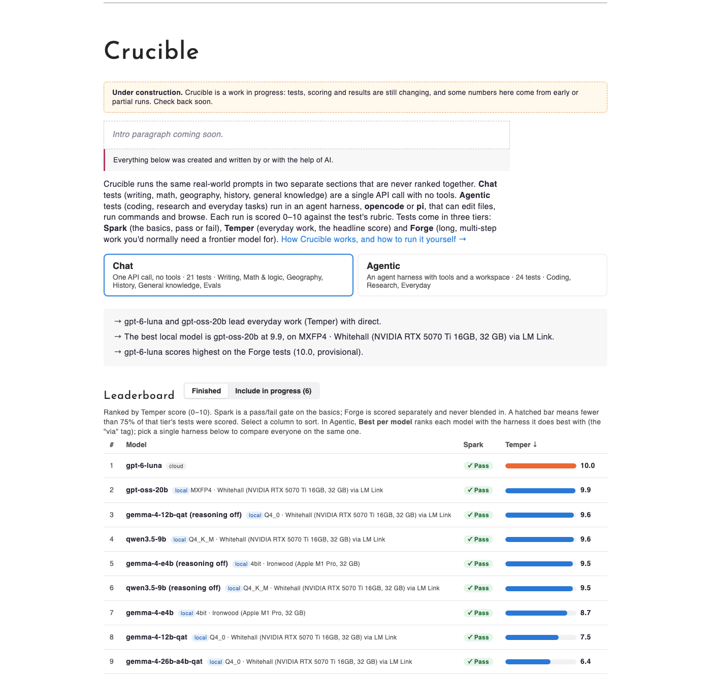
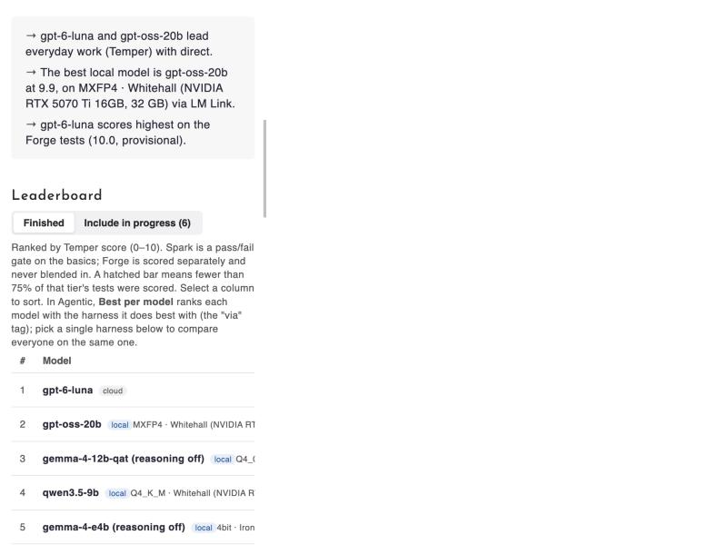

# Suite v2 audit and proposal

Status: **decisions recorded** (section 8), 2026-10-28. Nothing in this document has been implemented. The
only files this audit added are this document and the screenshots in `docs/v-next-audit/`.

Sources: AGENTS.md, CLAUDE.md, README.md, CHANGELOG.md, `.claude/skills/publish-results/`,
issues schaferandrew/crucible#30 and schaferandrew/crucible#13, every file in `prompts/`,
`crucible/{taxonomy,exporter,bundle,environment,hardware,runner,workspace,versioning,checks}.py`,
`crucible/schemas/results.schema.json`, `releases/2026.11.yaml`, the 394 run folders in `runs/`
(exported with `crucible export` to a scratch file, 345 runs, 196 counting), and the
portfolio's `crucible.html`, `crucible-about.html`, `assets/js/crucible.js` and
`_sass/pages/_crucible.scss`. Screenshots are of the live page (www.schaferandrew.com/crucible/,
data committed 2026-10-28 22:17).

Contents

0. [What I found, in one page](#0-what-i-found-in-one-page)
1. [Per-task audit](#1-per-task-audit)
2. [Naming: tests become tasks](#2-naming-tests-become-tasks)
3. [Bundle contract and breaking changes](#3-bundle-contract-and-breaking-changes)
4. [Dashboard review](#4-dashboard-review)
5. [Suite versioning and release rules](#5-suite-versioning-and-release-rules)
6. [Run data model](#6-run-data-model)
7. [Release plan](#7-release-plan)
8. [Decisions for you](#8-decisions-for-you)

---

## 0. What I found, in one page

**Scoring bugs that are live on the dashboard today**

| # | Problem | Evidence | Fix |
|---|---|---|---|
| B1 | **HIST-2 gives a perfect answer 5/10.** `no_false_flags` forbids any `→` line that mentions Runnymede, but the correct fix for the King Richard error quotes the original sentence, which contains "Runnymede". | gpt-6-luna's answer corrects all five errors and flags nothing else; it scores 5.0. Five of ten models lose these 5 points this way. | Restructure the task around numbered claims and an `ERRORS:` block scored item by item (section 1, HIST-2). Version bump; rerun. |
| B2 | **An empty answer earns points.** `distinct_names` and `each_described` pass on 0 list items. | gemma-4-26b-a4b-qat timed out on WRIT-2 with no output and scored 4.0 (counted); WRIT-2b 2.0. | Every check fails on an empty answer (one rule in `checks.py`: "no answer to check" is a fail for every type). Rubric bump for all tests. |
| B3 | **Coding graders pay for doing nothing.** "Existing tests still pass", "Contract suite untouched" and some hidden tests pass on the seeded repo. | gpt-oss-20b ran CODE-11 to 15 in 3 to 15 s with zero commits and scored 2.0, 3.0, 2.0, 5.9, 2.3. gemma-4-e4b got the same 5.9 and 2.3. | Convert to isolated per-test graders whose oracle requires `seeded: [0, 0]`, as CODE-16 does. Make "existing tests" and "contract untouched" caps, not points. |
| B4 | **WRIT-1c's `fixes_treasury` is both loose and strict.** It passes when "Treasury securities" appears anywhere (gemma-4-12b-qat passed while explaining QE, without fixing the sentence) and fails 8 of 12 runs that left the quoted original lowercase. | 7.0 is the modal score; the 3 points mostly measure whether the model happened to write "Treasury". | Require the corrected sentence (`buy Treasury bonds`) inside a "corrected text" section, or replace the planted error with an unambiguous one. |
| B5 | **CODE-5's answer is in the repo.** `repos/login-service/server.js:29` says `// C5: intermittent blank dashboard - triggered when session is expired` and line 114 says `// C5 BUG: Returns 200 with blank data`. | The agent reads `server.js` to debug it. | Strip the comments (version bump). Grep every seeded repo for `C\d|BUG|TODO: fix` before Suite v2. |

**Shape of the suite**

- 51 prompts: 6 retired, 19 judge-scored (KNOW-4 partly), 26 fully deterministic (20 chat with checks, CODE-11 to 16 with hidden tests). Your starting
  list was right, with two refinements: KNOW-4 is 5 checks + 2 judge criteria (8 of 10 points
  checked), and CODE-13 is 5 hidden-test criteria + 2 checks on the postmortem.
- Verdicts (accepted, D2): **keep 13** (4 rescored per item), **convert 25** (the CODE-11 to 15
  graders, and 7 chat tasks rewritten around scored answer blocks), **retire 13** (6 already retired). Details in section 1.
- Saturation: WRIT-1a, WRIT-2, WRIT-2b, KNOW-1, MATH-1, GEOG-1, WRIT-3 and EVAL-1 are 10/10
  for every model that answered. On the Chat leaderboard the top six models sit between 9.5
  and 10.0 Temper: the headline doesn't separate them.
- Nothing in the run data identifies a run permanently, records which Crucible produced it,
  or tells two quants of a model apart in the dashboard. Cloud runs record the laptop's
  hardware (37 runs show "Apple M1 Pro" for OpenRouter models).

**Proposal in brief**

- Tasks are identified by a **kebab-case slug** (`react-lead-form`); old IDs become aliases.
- **Crucible 3.0.0** carries every breaking change at once: the task rename, `test` → `task`
  in the CLI and YAML, run layout, and **bundle format 3** (a catalog plus one file per run).
- **Suite v2** is the first frozen, public task set. Tasks land `provisional`; `crucible suite
  cut` promotes and freezes them. Task IDs leave the tool's stable surface.
- Every run gets a **`run_uuid`** at creation; publish copies only runs whose UUID is new, and
  rescoring appends a score record instead of touching the run.
- The dashboard reads tiers, areas, labels, weights and thresholds from the bundle, and
  stops inlining 1.3 MB of JSON into the HTML.

---

## 1. Per-task audit

How to read this:

- **Runs** is the per-model score spread on the current task version (best run per model,
  checks or hidden tests only, provisional included). "sat." means every model that answered
  scored ≥ 9.7.
- **Verdict**: keep, keep + fix (a check is wrong), convert, or retire.
- **Effort**: S ≈ an hour or two, M ≈ half a day to a day (new grader or check type plus
  calibration), L ≈ several days (browser automation in the grader, new fixture world).
- I validated checks against the real outputs in `runs/` (there is at least one correct and
  one wrong answer for every chat task), not against invented answers. Where a check passed or
  failed for the wrong reason I say so.

### Chat

| Old ID | Tier | Scoring today | Runs (models: min / median / max) | Verdict | Reason and how | Effort |
|---|---|---|---|---|---|---|
| WRIT-1a | spark | 7 checks | 11: 10 / 10 / 10, sat. | **convert** | Checks scan the whole reply, so a correction quoted in an explanation passes and an apology quoted while explaining fails. Move to an [answer block](#answer-blocks-task-by-task): `ERRORS:` and `CORRECTED:` blocks, checks scoped to each. Saturated by design for Spark. | S |
| WRIT-1b | temper | 6 checks | 11: 9 / 10 / 10 | **convert** | Same problem as WRIT-1a: fixes and kept fragments can pass by being quoted in commentary. [answer block](#answer-blocks-task-by-task): `CORRECTED:` and `POSSIBLY INTENTIONAL:` blocks. Near-saturated; consider Spark. | S |
| WRIT-1c | temper | 4 checks | 11: 7 / 7 / 10 | **convert** | B4. Rebuild as numbered sentences like HIST-2: 2–3 unambiguous planted language errors (drop "treasury"), the planted overstatements, and some accurate control sentences. [answer block](#answer-blocks-task-by-task): `ERRORS:` (sentence: fix) and `FLAGS:` (sentence numbers). | S |
| WRIT-2 | temper | 5 checks | 11: 10 / 10 / 10, sat. | **retire** | Duplicate of WRIT-2b (20 names, no famous names) and saturated; its empty-answer score is B2. The blocklist can't tell a "generator name" from a real one, which was half the prompt's intent. | — |
| WRIT-2b | temper | 5 checks | 11: 10 / 10 / 10, sat. | **convert** | B2 (empty answer scores 2.0); `explains_top_five` passes on the words "top five" anywhere. [answer block](#answer-blocks-task-by-task): `NAMES:` (20 numbered lines, name — reason) and `TOP FIVE:` (5 names from the list). Fit-to-brief isn't checkable, so if it stays saturated, add explicit constraints (decision D11). | S |
| WRIT-3 | spark | 3 checks | 11: 10 / 10 / 10, sat. | keep | Clean checks, good gate. Promote. | — |
| MATH-1 | spark | 2 checks (2 pts) | 10: 10 / 10 / 10, sat. | keep | Fine as a gate. Only 2 points, so one slip is −5: add two more items in the next suite. | S |
| MATH-2 | temper | 4 checks | 10: 0 / 8.5 / 10 | keep + rescore | Best discriminator in Chat. Answers verified (5,636.36; 87; 47.14; 54.34). Already has an `ANSWERS` block; give the four items equal weight (3/2/2/3 today). Rubric bump, rescore only. | S |
| MATH-3 | forge | 5 checks | 10: 0 / 10 / 10 | keep | Unambiguous wording (Tuesday-boy assumptions are stated). The 0s are timeouts, not check errors. | — |
| MATH-4 | temper | 4 checks | 12: 0 / 10 / 10 | **convert** | Unique solution (verified). `seating` is 4 points all-or-nothing; `assumptions` is `\bassum` (passes on any "assume", fails deepseek for writing "Interpreting 'left' as…"); `no_wrong_answer` duplicates `answer`. [answer block](#answer-blocks-task-by-task): keep the `Chair n:` lines and `ANSWER:`, score 5 equal items (four chairs, the answer), drop the assumptions criterion. | S |
| GEOG-1 | spark | 2 checks | 10: 10 / 10 / 10, sat. | keep + rescore | The capitals check passes if the names appear anywhere ("not Sydney but Canberra"), and the trap check duplicates it. Score the six `Country: Capital` lines the prompt already asks for as six equal items. Rescore only. Gate. | S |
| GEOG-2 | temper | 3 checks | 10: 0 / 6.5 / 10 | keep + rescore | Already answers in three fixed lines, but "all 11 landlocked found" is 4 points all-or-nothing: gemma-4-12b-qat (reasoning off) found 10 of 11 and got 0 for it. Score 16 equal items instead (each of the 15 countries on the right line, plus the doubly landlocked one). Rescore only. | S |
| GEOG-3 | forge | 6 checks | 9: 0 / 8.3 / 10 | keep | Wording is tight. | — |
| HIST-1 | spark | 2 checks | 10: 5 / 10 / 10 | **convert** | `order` is one regex over the whole reply (5 pts all-or-nothing) and `years` passes if the years appear anywhere. [answer block](#answer-blocks-task-by-task): `ORDER:` with six numbered `event — year` lines. Items: 15 event pairs in the right order (one swap costs 1 of 15, not half the score) and 6 years. | S |
| HIST-2 | temper | 6 checks | 10: 5 / 6 / 10 | **convert** | B1, and prose answers are the root cause. Restructure as in [the answer-block convention](#answer-block-convention): number the 8 claims, one fact per line, every false claim correctable to a single year or name (Titanic becomes "April 1913"; "reunified the following year" becomes its own, clearly true, line 8). End with `ERRORS:` / `<line>: <corrected value>`. 13 equal items: 5 errors found, 5 corrections right, 3 accurate lines not flagged. Version 2 (rerun). If it saturates, add subtler claims rather than prose. | S |
| HIST-3 | forge | 2 checks | 9: 0 / 5 / 10 | keep + rescore | Good spread; the `ANACHRONISMS:` line worked in every completed run. Score 11 equal items (each letter correctly in or out) instead of two all-or-nothing halves. Rescore only. | S |
| KNOW-1 | spark | 3 checks | 13: 10 / 10 / 10, sat. | keep | A sanity gate (fire-truck color). | — |
| KNOW-2 | temper | judge | retired | retire (done) | Open-ended explanation. | — |
| KNOW-3 | temper | judge | retired | retire (done) | Open-ended explanation. | — |
| KNOW-4 | temper | 5 checks + 2 judge | 9 runs, none counting (provisional) | **convert** | "Disputes handled" → required patterns: all three crowd estimates (300, 1,000, 400) each within a sentence of its source name. "Deduplicated" → a `mentions_once` check: the levy, fire and rally each appear under exactly one item (count list items or headings containing each story's key term). Both deterministic on the fixed feed. | S |
| KNOW-5 to 8 | temper | judge | retired | retire (done) | Home-repair advice. | — |
| EVAL-1 | spark | grade closeness | 9: 9.7 / 10 / 10, sat. | keep | Gate. The reference grade is public in the bundle (`detail: "graded 9, reference 9"`); see decision D7. | — |
| EVAL-2 | temper | grade closeness | 9: 3.7 / 10 / 10 | keep | | — |
| EVAL-3 | temper | grade closeness | 9: 8.9 / 10 / 10 | keep | Near-saturated. Fine, but don't add more cases of the same shape. | — |

### Agentic

| Old ID | Tier | Scoring today | Runs | Verdict | Reason and how | Effort |
|---|---|---|---|---|---|---|
| CODE-1 | temper | judge | 7 models | **retire** | "Decide what inputs and features the tool should provide": scoring that is judgment by design. CODE-1b is the same tool with a spec. | — |
| CODE-1b | temper | judge | 6 models | **convert** | Pin the interface in the prompt (language, entry point, flags, a `--json` output shape), then an isolated per-test grader: known-value cases (monthly compounding, zero rate, contributions at both frequencies, years and months), invalid inputs exit non-zero with a message, the model's own tests run green. Reference `solution/`, calibration fixtures "no contributions" and "annual-only compounding". | M |
| CODE-2 | temper | judge | 3 models | **retire** | Vague twin of CODE-2b; "visual bugs/design" (5 of 15 pts) can't be checked. | — |
| CODE-2b | temper | judge | 4 models | **convert** | Its prompt starts "Now make…", a follow-up to CODE-2; as a standalone task rewrite it to state the whole requirement. Grader needs a real browser (overflow and visibility don't exist in jsdom): Playwright at 375 and 1280 px, checking no horizontal overflow (`scrollWidth ≤ innerWidth`), links visible on desktop and hidden behind a button on mobile, `aria-expanded` toggles, keyboard open/close, every original destination reachable. | L (first Playwright grader) |
| CODE-3 | temper | judge | 2 models | **convert** | Isolated grader: `next build` passes, `/` server-renders acct_1's name and plan, the data module never reaches a client bundle (grep `.next/static` for its marker; this replaces the critical-failure cap), a regression test exists and fails on the seeded code. | M |
| CODE-4 | temper | judge | 2 models | **convert** | The server can record what happened. Add an audit log to `login-service` and grade on it: ended with a valid session for `testuser`, used the reset flow (not a code change), app files unchanged (`git diff` outside allowed paths), and the final answer names the seeded failure (`wrong password` pattern). | M |
| CODE-4b | temper | judge | 1 model | **retire** | "Repeat the task from a fresh browser state": a follow-up of CODE-4 with the same seeded failure. If a second failure mode is wanted, make it a separate seeded task. | — |
| CODE-5 | forge | judge | 1 model | **convert** | Fix leak B5 first. Make the "intermittent" trigger deterministic (expired session at a known request), then hidden tests: the API returns 401 rather than 200-with-blank for an expired session, the UI shows a login prompt, the model's regression test fails on seeded code. | M |
| CODE-6 | temper | judge | 2 models | **retire** | An interactive Next.js course: teaching quality is subjective, and "wait for my answer" can't be scored in one turn. | — |
| CODE-11 | forge | hidden tests (in-workspace) | 4 models | keep → **convert grader** | Good task, broken baseline (B3). Move to `isolated: true`, `scoring: per_test`, add `solution/`, `calibration/` and `expected.json`, oracle `seeded: [0, 0]`. Stored workspaces can be rescored, so no rerun is needed. | M |
| CODE-12 | forge | hidden tests | 3 models | keep → **convert grader** | Same as CODE-11. "Backward compatibility" passes on the seeded repo: under per-test scoring, keep it as a cap instead of points. | M |
| CODE-13 | forge | hidden tests + 2 checks | 3 models | keep → **convert grader** | Same as CODE-11. The postmortem checks run on the written file, which is fine; validated (deepseek passes, gemma fails with the timestamps missing). | M |
| CODE-14 | forge | hidden tests | 2 models | keep → **convert grader** | Same as CODE-11. 3.9 of its points pass on the seeded repo today. | M |
| CODE-15 | forge | hidden tests | 2 models | keep → **convert grader** | Same as CODE-11. `No axe violations` passes on the seeded repo. | M |
| CODE-16 | temper | isolated, per test | 2 models | **keep** | The reference shape for every other coding task. | — |
| RSCH-1 | temper | judge | 1 model | **retire** | Today's news for Saint Paul: live data, unscorable by construction. KNOW-4 already tests briefings from fixed sources. | — |
| RSCH-2 | temper | judge | 2 models | **retire** | Live weather with a self-chosen source. | — |
| RSCH-2b | spark | judge | 2 models | **convert** | Keep the skill (fetch a JSON API, compute an average) but freeze the world: point the `web` MCP server at a recorded fixture host for a fixed date (Open-Meteo-shaped current and archive responses, NOAA normals), state the date in the prompt, require `CURRENT:` / `AVERAGE:` / `VERDICT: typical|outlier` lines, check numbers against the fixture and that `web_fetch` was called on both endpoints (session log). This is the only task left in the Research area. | M |
| TASK-1 | temper | judge | 4 models, none scored | **convert** | Fixture window is fixed (2026-08-31 to 09-07), so ground truth is computable. Ask for a JSON file with `valid_slots` and `top3`. Checks: `valid_slots` equals the computed set, `top3 ⊆ valid_slots`, valid JSON with `explanation` strings. Either define the ranking precisely (a scoring function in the prompt) or stop scoring the order. Needs a small `json_answer` check type. | S–M |
| TASK-2 | spark | judge, 1 criterion | 2 models | **convert** | Checks: last paragraph is Spanish and the rest is English (a stopword-ratio check, deterministic), and the brief mentions the two mock emails' subjects, today's mock events and one mock news item (required patterns from the fixtures). | S |
| TASK-3 | temper | judge | 2 models, none scored | **convert** | Remove "use live sources if available" (live data); serve weather and news from `mock-data`. Checks: section order by heading, a "Top 3" section with exactly 3 items, each seeded conflict/deadline/unanswered email is mentioned, `grounded_numbers` against the fixtures. Prioritization becomes "mentions the seeded must-act items", which is as far as determinism goes. | M |
| TASK-4 | spark | judge | 3 models | **convert** | Ground truth is in the YAML and `free_starts()`. Add `ANSWER: free|busy` to the prompt; check it, check "PM" or "this afternoon" is stated, and check from the session that `get_current_time` and `list_events` were called (replaces "grounded in the calendar"). | S |
| TASK-5 | temper | judge | 2 models | **convert** | Require an `OPTIONS:` line with ISO-like datetimes; a `time_options` check parses them and scores against the ground-truth start set (all valid, at least 2, at least one on Thu 13:00 or Fri, which tests declined/transparent handling). | S |
| TASK-6 | forge | judge | 2 models | **convert** | Same `time_options` check against its ground-truth set, plus: no option on Labor Day or 9/10–9/11, none after 16:00 Central, exactly three. "Identifies the team" is implied by validity; also check `get_freebusy` covered the 15 Platform calendars (session). | S |

<a id="answer-block-convention"></a>
### Answer blocks, task by task

<a id="answer-blocks-task-by-task"></a>
**The convention.** It mirrors CODE-16's per-test scoring:

1. **Inputs are numbered and atomic.** Each claim, sentence, country or event is a separately
   numbered item with one checkable fact, so there's no doubt about what an answer refers to
   (the HIST-2 "reunified the following year" problem).
2. **The model reasons in free prose, then ends with a fixed block** (`ANSWERS:`, `ERRORS:`,
   `ORDER:`, …) with one item per line. Only the block is scored, so wording in the explanation
   can't pass or fail a check.
3. **Each expected item is scored on its own, with equal weight;** the task score is items
   passed / all items x 10, like `scoring: per_test`. Today a check is all or nothing per
   criterion, so GEOG-2 gives 0 of 4 for 10 of 11 countries found.
4. **Normalization only for short values** (numbers, names with listed aliases, letters, line
   numbers, dates): case, punctuation, thousands separators, accents, `**bold**` markers and code
   fences. Never fuzzy-match sentences.
5. **A missing or unparseable block scores 0,** and so does an empty answer (B2). Accept the
   common block variants (`**ANSWERS**`, `Answers:`, a fenced block) and take the last block
   when a model writes a draft one first.
6. **Accurate controls.** A detection task includes items that are correct, and leaving them
   out of the block is itself an item, so flagging everything can't win.

**Where it applies.** "Rerun" means the prompt changes (version bump), and "rescore" means
stored outputs can be scored again (rubric bump only).

| Task | Today | Block | Items (equal weight) | Rerun or rescore |
|---|---|---|---|---|
| WRIT-1a | 7 checks on the whole reply | `ERRORS:` (`<original> → <fix>` per line), `CORRECTED:` (the email), `STYLE:` (optional suggestions) | 3 planted errors listed and fixed in `CORRECTED`; 5 facts kept in `CORRECTED`; no apology added in `CORRECTED`; `STYLE` separate from `ERRORS` (no style item listed as an error) | rerun |
| WRIT-1b | 6 checks on the whole reply | `CORRECTED:` (the paragraph), `POSSIBLY INTENTIONAL:` | `than` and `too` fixed in `CORRECTED`; 3 fragments, the dash and the opening imagery kept verbatim in `CORRECTED`; "laugh, or leave" (or another fragment) listed as possibly intentional, not silently changed | rerun |
| WRIT-1c | 4 checks, B4 | Sentences numbered in the prompt. `ERRORS:` (`<n>: <fix>`), `FLAGS:` (`<n>: overstated|imprecise|unclear|misleading`) | each planted language error fixed; each planted overstatement's sentence flagged; each accurate control sentence not flagged | rerun |
| WRIT-2b | list checks on the whole reply | `NAMES:` (20 numbered `First Last — reason` lines), `TOP FIVE:` | 20 lines; all distinct; each has a reason; 5 top names, all from the list; none on the blocklist (plus any explicit constraints, D11) | rerun |
| WRIT-3 | 3 checks | none; the haiku is the answer | Optionally a `HAIKU:` block, so a preamble ("Here's a haiku:") can't break the three-line check. A syllable check (5-7-5, pinned dictionary) would add signal but is approximate: decision D11. | rerun if adopted |
| MATH-1, MATH-3 | `ANSWERS` block, equal points | already conforms | — | — |
| MATH-2 | `ANSWERS` block, 3/2/2/3 points | already conforms | 4 equal items | rescore |
| MATH-4 | `Chair n:` lines + `ANSWER:`; seating all-or-nothing | already has the block | 4 chairs + the answer; drop `assumptions` and `no_wrong_answer` | rerun (prompt drops the assumptions instruction) or rescore if the prompt stays |
| GEOG-1 | names anywhere | `Country: Capital` lines (already asked for) | 6 lines, each the right capital | rescore (the format is already in the prompt) |
| GEOG-2 | 3 fixed lines, all-or-nothing | already conforms | 15 countries on the right line + doubly landlocked = 16 | rescore |
| GEOG-3 | `ANSWERS` block, 6 × 1 | already conforms | — | — |
| HIST-1 | regex over the whole reply | `ORDER:` with 6 numbered `event — year` lines | 15 pairs in the right order + 6 years (Gutenberg: 1450–1456) = 21 | rerun |
| HIST-2 | B1 | numbered claims, `ERRORS:` | 13 (see the HIST-2 row) | rerun |
| HIST-3 | `ANACHRONISMS:` line, two halves | already conforms | 11 letters, each correctly in or out | rescore |
| KNOW-1 | 3 checks | `ANSWER: <color>` after the one or two sentences | answer is red; the sentences stay under 60 words | rerun (low value: a saturated gate; optional) |
| KNOW-4 | 5 checks + 2 judge on prose | Sources numbered `[S1]`…`[S10]` in the prompt. The briefing stays prose, one story per paragraph, each ending with its sources, e.g. `[S1, S2, S9]` | each of the 9 current sources cited exactly once (dedup), S10 (stale) not cited, the opinion column cited as opinion; per story paragraph: levy figures, the corrected injury count, all three crowd estimates, bill "expected to sign"; `grounded_numbers` over the whole briefing | rerun |
| EVAL-1 to 3 | `GRADE:` line | already conforms | — | — |

**Agentic tasks: the same idea, applied to final answers and files.**

| Task | Block | Items |
|---|---|---|
| TASK-1 | `slots.json`: `{"valid_slots": [...], "top3": [{"start", "explanation"}]}` | each true slot listed, no false slot listed, top 3 all valid, each has an explanation |
| TASK-4 | `ANSWER: free|busy` | the answer, "PM today" stated, `get_current_time` and `list_events` called (session) |
| TASK-5, TASK-6 | `OPTIONS:` lines, `YYYY-MM-DD HH:MM <time zone>` | each option valid against the ground-truth set, the right number of options, TASK-6's traps avoided |
| TASK-2, TASK-3 | fixed `##` section headings in a set order, a `## Top 3` list | per section present and in order; per seeded item (email, conflict, deadline) mentioned in its section; Spanish only in the last section (TASK-2) |
| RSCH-2b | `CURRENT:`, `AVERAGE:`, `VERDICT:` | each value within tolerance of the fixture; the verdict follows from them; both endpoints fetched |
| CODE-13 | `incident/POSTMORTEM.md` gets fixed lines: `Deploy: HH:MM:SS`, `First affected request:`, `First report:`, `Affected users: <n>` | each timestamp, and the count (371, or 481 with the stated alternative); today the patterns match anywhere in the file, so a stray "481" passes |
| CODE-11 to 16 | hidden tests | already per test |

**What this costs.** One engine feature, not per-task code: an answer-block parser (header,
lines until a blank line or the next header, the last block wins) and an `items` check with a
small set of normalizers (`number`, `money`, `name` with aliases, `letter_set`, `line_number`,
`datetime`, `ordering` for pairs). Each task then declares its expected items in YAML. Validation
per task: the reference answer scores 10, an empty answer 0, and two real wrong answers from
`runs/` land where expected, the same oracle idea as `crucible grader`.

**Trade-off.** Scoring only the block means a model that knows the answer but ignores the
format scores 0. That's intended: following an explicit output format is part of the task, and
it's the same for every model. Keep the format instruction worded identically across tasks, so
it isn't harder in one than another.

**Totals:** keep 13 (4 of them rescored per item: MATH-2, GEOG-1, GEOG-2, HIST-3) · convert 25 (CODE-11 to 15 and the answer-block rewrites count here) · retire 13 (CODE-1, CODE-2, CODE-4b,
CODE-6, RSCH-1, RSCH-2, WRIT-2, plus the 6 KNOW already retired).

**Duplicates:** CODE-1/1b, CODE-2/2b, CODE-4/4b, RSCH-2/2b, WRIT-2/2b: in each pair one is kept or
converted and the other retired. EVAL-1 and EVAL-3 overlap in difficulty, but not in content.

**Leaks:**
- B5 (CODE-5 answer in a comment).
- Every chat answer is published: `rules` in the bundle ("Answer 2 is $71.91"), `docs/checks.md` in
  the public repo, and EVAL's reference grade in each run's `detail`. For a personal benchmark
  that's the point (auditability). For a public one it means models can be trained on the
  answers. See decision D7.
- Hidden tests and ground truth live in the public repo (`graders/`, YAML comments). Workspace
  isolation keeps them from the agent during a run, so this is a contamination risk, not a
  cheating risk.

**Coverage after the verdicts:** Research has one task left (converted RSCH-2b), and Agentic Spark
has only TASK-4 and TASK-2. Both are thin for a tier score; see the release plan for what counts
in Suite v2.

---

## 2. Naming: tests become tasks

### The identifier

**Recommendation: the stable ID is a kebab-case slug** (`react-lead-form`), the display title
is `name` ("React lead form"), and the old code (`CODE-16`) becomes an alias.

Why a slug and not "keep IDs and add names":
- Area-prefixed codes encode taxonomy in identity. Moving a task to another area or splitting an
  area renames it, which is exactly what made 1.0.0 a rename-everything major. A slug encodes
  only what the task is.
- Numbers carry no meaning to a stranger and invite the `1b`/`2b` variant style, which turned
  out to mean "follow-up conversation" in some places and "harder version" in others.
- A slug is readable in a URL (`/crucible/#task=react-lead-form`), a run path and a CLI.

Rules for slugs (enforced by a validator replacing `validate_area`'s regex):
- `^[a-z0-9]+(-[a-z0-9]+)*$`, at most 40 characters, unique forever: a retired slug is never reused.
- Describes the task, not its tier, area or difficulty (no `-hard`, no `-forge`).
- Renaming a slug is allowed but costs a suite major; the old slug joins `aliases`.

### Where "test" becomes "task"

| Surface | Today | Suite v2 / Crucible 3 |
|---|---|---|
| Task files | `prompts/CODE-16.yaml`, key `test_id:` | `tasks/react-lead-form.yaml`, key `id:` plus `aliases: [CODE-16]` |
| Graders | `graders/temper/CODE-16/` | `graders/react-lead-form/` (no tier folder: a tier change shouldn't move files) |
| Run folders | `runs/<model>/<category>/<test_id>/<ts>/` | `runs/<model>/<task>/<ts>/` (category dropped from the path; see section 6) |
| CLI | `crucible run CODE-16`, `--skip-done` "tests", `crucible grader <test>`, `crucible checks` | `crucible run react-lead-form` (aliases still accepted, with a one-line notice), `crucible task list`, `crucible task show <task>`, `crucible grader <task>`. Menus and help say "task". |
| meta.json | `test_id`, `test: {version…}` | `task: {id, version, rubric_version, content_hash, alias}` |
| Bundle | `tests[]`, `run.test_id`, `test_version` | `tasks[]`, `run.task.id`, `run.task.version` |
| Dashboard | "Every model on every test", "tests", test ID column | "Every model on every task", task `name` as the label, slug in the detail panel, old code shown as "formerly CODE-16" |
| Docs | README "Running tests", `test-tiers.md`, `docs/checks.md` headings | "Running tasks", `task-tiers.md`, checks doc keyed by name and slug |
| Words that stay | "hidden tests", "unit tests", `npm test`, grader test files | These are software tests, not benchmark tasks; leave them. |

### Old-to-new map

Proposed `docs/task-id-map.json` (draft slugs; the names follow the same words). It supersedes
`docs/test-id-map.json`; chain the old map through it so `C11` → `CODE-11` →
`editorial-review-workflow` resolves in one lookup.

```json
{
  "CODE-1":  {"id": "interest-cli-open-ended",     "name": "Interest CLI (open-ended)",      "status": "retired"},
  "CODE-1b": {"id": "interest-calculator-cli",     "name": "Interest calculator CLI"},
  "CODE-2":  {"id": "responsive-navbar-open-ended","name": "Responsive navbar (open-ended)", "status": "retired"},
  "CODE-2b": {"id": "navbar-hamburger-menu",       "name": "Navbar hamburger menu"},
  "CODE-3":  {"id": "nextjs-server-data-boundary", "name": "Next.js server data boundary"},
  "CODE-4":  {"id": "login-recovery",              "name": "Log in and recover"},
  "CODE-4b": {"id": "login-recovery-repeat",       "name": "Log in and recover, again",      "status": "retired"},
  "CODE-5":  {"id": "blank-dashboard-debug",       "name": "Blank dashboard after login"},
  "CODE-6":  {"id": "nextjs-course",               "name": "Teach me Next.js",               "status": "retired"},
  "CODE-11": {"id": "editorial-review-workflow",   "name": "Editorial review workflow"},
  "CODE-12": {"id": "cursor-pagination",           "name": "Cursor pagination"},
  "CODE-13": {"id": "cache-leak-incident",         "name": "Cache leak incident"},
  "CODE-14": {"id": "invite-signup-loop",          "name": "Invite sign-up loop"},
  "CODE-15": {"id": "accessibility-audit-fixes",   "name": "Accessibility audit fixes"},
  "CODE-16": {"id": "react-lead-form",             "name": "React lead form"},
  "EVAL-1":  {"id": "grade-palindrome-function",   "name": "Grade a palindrome function"},
  "EVAL-2":  {"id": "grade-two-sentence-summary",  "name": "Grade a two-sentence summary"},
  "EVAL-3":  {"id": "grade-binary-search-answer",  "name": "Grade a binary search answer"},
  "GEOG-1":  {"id": "capitals-not-largest-city",   "name": "Capitals, not the largest city"},
  "GEOG-2":  {"id": "landlocked-countries",        "name": "Landlocked countries"},
  "GEOG-3":  {"id": "geography-trick-questions",   "name": "Geography trick questions"},
  "HIST-1":  {"id": "order-historical-events",     "name": "Put events in order"},
  "HIST-2":  {"id": "fact-check-history",          "name": "Fact-check a history paragraph"},
  "HIST-3":  {"id": "letter-from-1863",            "name": "Anachronisms in an 1863 letter"},
  "KNOW-1":  {"id": "fire-truck-color",            "name": "Fire truck color"},
  "KNOW-2":  {"id": "explain-enshittification",    "name": "Explain enshittification",       "status": "retired"},
  "KNOW-3":  {"id": "explain-solar-panels",        "name": "Explain solar panels",           "status": "retired"},
  "KNOW-4":  {"id": "news-briefing-from-feeds",    "name": "News briefing from feeds"},
  "KNOW-5":  {"id": "sink-leak-advice",            "name": "Leak under the sink",            "status": "retired"},
  "KNOW-6":  {"id": "running-toilet-advice",       "name": "Running toilet",                 "status": "retired"},
  "KNOW-7":  {"id": "cold-window-advice",          "name": "Cold room by a window",          "status": "retired"},
  "KNOW-8":  {"id": "furnace-wont-start-advice",   "name": "Furnace won't start",            "status": "retired"},
  "MATH-1":  {"id": "recipe-and-discount",         "name": "Recipe scaling and a discount"},
  "MATH-2":  {"id": "household-money-math",        "name": "Household money math"},
  "MATH-3":  {"id": "competition-math",            "name": "Competition counting and probability"},
  "MATH-4":  {"id": "seating-logic-puzzle",        "name": "Seating logic puzzle"},
  "RSCH-1":  {"id": "todays-local-news",           "name": "Today's local news",             "status": "retired"},
  "RSCH-2":  {"id": "live-weather-open-ended",     "name": "Live weather (open-ended)",      "status": "retired"},
  "RSCH-2b": {"id": "weather-vs-normal",           "name": "Weather against the normal"},
  "TASK-1":  {"id": "two-calendar-slots-json",     "name": "Meeting slots from two calendars"},
  "TASK-2":  {"id": "morning-brief-spanish",       "name": "Morning brief with Spanish practice"},
  "TASK-3":  {"id": "morning-brief-priorities",    "name": "Morning brief, prioritized"},
  "TASK-4":  {"id": "calendar-free-at-330",        "name": "Am I free at 3:30?"},
  "TASK-5":  {"id": "calendar-hour-with-jamie",    "name": "An hour with Jamie"},
  "TASK-6":  {"id": "calendar-team-of-16",         "name": "An hour for a team of 16"},
  "WRIT-1a": {"id": "proofread-customer-email",    "name": "Proofread a customer email"},
  "WRIT-1b": {"id": "proofread-literary-paragraph","name": "Proofread a literary paragraph"},
  "WRIT-1c": {"id": "proofread-economics-essay",   "name": "Proofread an economics essay"},
  "WRIT-2":  {"id": "novel-character-names",       "name": "Character names for a novel",    "status": "retired"},
  "WRIT-2b": {"id": "names-for-one-character",     "name": "Names for one character"},
  "WRIT-3":  {"id": "river-haiku-banned-words",    "name": "River haiku without water"}
}
```

Retired tasks get slugs too: their runs stay in the data, and a slug is never reused.

---

## 3. Bundle contract and breaking changes

### What the site hard-codes today

| Where | Hard-coded | Should come from |
|---|---|---|
| `crucible.js:24` | `MODE_BLURBS` ("One API call, no tools"…) | `modes[].blurb` |
| `crucible.js:25-26` | `TIER_LABELS`, `TIER_BLURBS` for spark/temper/forge | `tiers[].label`, `tiers[].blurb` |
| `crucible.js:27,30` | `COVERAGE_MIN = 0.75`, `IN_PROGRESS_BELOW = 0.75` | `scoring_policy` |
| `crucible.js:31` | `SPARK_PASS = {mean: 8, min: 5}` | `tiers[spark].gate` |
| `crucible.js:35` | `COLORS = {local, cloud}` | stays in CSS (presentation), keyed by `where` |
| `crucible.js:48` | `isLocal` by provider prefix `ollama|lmstudio` | `run.endpoint.where` |
| `crucible.js:41-45` | `modelLabel` = last path segment, `#reasoning` suffix (drops publisher and quant: issue #30) | `run.model.display` and the variant key |
| `crucible.js:296-308,~370-470` | Leaderboard columns `spark`, `temper`, `forge`; headline is `temper`; Forge falls back to provisional | `tiers[]` with `role: gate|headline|stretch` |
| `crucible.js` (takeaways, scatter) | "Temper", "Forge" in sentences | tier labels by role |
| `crucible.js:~584` | `if (mode === 'agentic')` adds a tool-calls column | `modes[].columns` or "show when any run has the metric" |
| `crucible.js:66-69` | Score precedence checks > human > judge | `run.score` already resolved by the exporter |
| `crucible.html` | Intro lists the areas, tiers, harnesses; "Forge… frontier"; caveat "Other tests are scored by an AI judge (Claude)"; "fewer than 75%" | Liquid over the catalog; drop judge text in v2 |
| `crucible-about.html` | Whole area table, examples (still lists retired KNOW tasks: "Explain enshittification… fix a leak"), tiers, "scored by a person or by an AI judge", "Published scores are always on a release" (not true: the code counts current versions, not the release pin) | Liquid over the catalog; fix the claims |
| `_sass/pages/_crucible.scss:1062` | `.is-forge` styling | `.is-role-stretch` or a data attribute |
| Bundle | `release` from the newest `releases/*.yaml`, but its `category_weights` (e.g. `coding_repo: 0.15`, no `math`) differ from `taxonomy.py`'s (`coding_repo: 0.10`, `math: 0.05`) and the site uses taxonomy's | one source: the suite file |
| Schema | `enum`s for tier, mode, reasoning, outcome, status | Open strings validated against the catalog |
| Merge | "newest bundle wins" for tests and settings | One catalog file per suite (section 6) |

### Proposed contract (bundle format 3)

The data splits into a **catalog** (what the suite is) and **run records** (what happened).
Section 6 covers runs; this is the catalog, `_data/crucible/catalog/<suite>.json`:

```json
{
  "format_version": 3,
  "format_revision": 0,
  "suite": {"id": "v2", "version": "2.0", "cut_at": "2026-11-15", "status": "current",
            "changelog_url": "https://github.com/schaferandrew/crucible/blob/main/SUITE_CHANGELOG.md#suite-v20"},
  "crucible_version": "3.0.0",
  "scoring_policy": {"coverage_min": 0.75, "in_progress_below": 0.75, "repeat_aggregate": "mean"},
  "modes":   [{"id": "chat", "label": "Chat", "blurb": "One API call, no tools", "order": 1}],
  "areas":   [{"id": "writing", "label": "Writing", "mode": "chat", "order": 1, "blurb": "…"}],
  "categories": [{"id": "writing", "label": "Writing", "weight": 0.10}],
  "tiers":   [{"id": "spark",  "label": "Spark",  "blurb": "the basics", "order": 1, "role": "gate",
               "gate": {"mean": 8, "min": 5}},
              {"id": "temper", "label": "Temper", "blurb": "everyday work", "order": 2, "role": "headline"},
              {"id": "forge",  "label": "Forge",  "blurb": "frontier-level work", "order": 3, "role": "stretch"}],
  "harnesses": [{"id": "direct", "label": "direct", "modes": ["chat"]}],
  "tasks": [{
    "id": "react-lead-form", "name": "React lead form", "aliases": ["CODE-16"],
    "mode": "agentic", "area": "coding", "category": "coding_debug", "tier": "temper",
    "status": "active", "version": 1, "rubric_version": 1, "weight": 0.05,
    "scoring": {"method": "hidden_tests", "unit": "tests", "total": 43, "scale": 10},
    "criteria": [{"id": "renders", "label": "Renders", "group": "level 1"}],
    "summary": "…", "prompt": "…", "rules": [], "added_in": "v2"
  }]
}
```

Notes:
- `weight` is resolved per task by the exporter (category weight split across the category's
  active tasks), so the site never repeats that arithmetic. The site can still group by category.
- `role` lets the site find the gate and the headline without knowing tier names.
- Provisional tasks are listed in the catalog with `status: provisional` and no weight.
- Everything is referenced by ID; labels are only ever read from the catalog.

### What is breaking

A change is **data-only** when the site renders it correctly with no code change and old runs
keep their meaning.

| Change | Bundle | Site | Suite | Crucible |
|---|---|---|---|---|
| Add a task to an existing area and category | data-only | data-only | provisional: none; promoting it: new suite | none |
| Retire a task, change a task's name, summary or prompt text shown | data-only | data-only | new suite (retire) / none (name) | none |
| Task `version` bump (content) | data-only | data-only | new suite major | none |
| Task `rubric_version` bump (check fix) | data-only | data-only | suite patch | none |
| Change category weights or tier gate thresholds | data-only | data-only | new suite major | none |
| Add an area, category or tier | data-only (catalog lists it) | renders generically (section 3, "unknown data") | **new suite major** | none |
| Rename an area, category or tier ID | **breaking** (old runs reference it) | breaking | new suite major | minor (exporter maps) |
| Add an optional field to tasks, runs or the catalog | `format_revision` +1 | none (ignored until used) | none | minor |
| Remove or rename a field, change a field's type or meaning, change the file layout or the identity keys | **`format_version` +1** | breaking | none | **major** |
| Rename task IDs | data-only after format 3 (`aliases`) | data-only | new suite major | none |

**How `format_version` signals it:** `format_version` is an integer that changes only for
breaking format changes; `format_revision` counts additive ones. The site declares
`SUPPORTED_FORMAT = 3`. On a run record or catalog with a higher `format_version`, it skips the
file and shows one line ("Some results were published with a newer Crucible than this page
understands"), never an error. A higher `format_revision` is always safe.

### Data the site doesn't recognize

- **Unknown area, category or tier in the catalog:** render it generically, after the known
  ones, by `order`; tier with no `role` is shown but never headlines or gates.
- **Unknown task ID in a run (not in any catalog):** keep the run (it's still a fact), don't
  count it, list it under "Other runs" in the model detail.
- **Unknown field:** ignore it.
- **Unknown enum value** (outcome, reasoning, harness): show the raw value as a tag, count
  per the run's own `counts` flag.
- **Malformed file:** Jekyll parse errors break the whole build, so validation must happen
  before commit: `crucible publish` validates every file it writes, and a portfolio CI job (or
  pre-commit) runs `crucible publish --check _data/crucible`.

---

## 4. Dashboard review

Screenshots (live site, 2026-10-28):
- [01-chat-leaderboard.png](v-next-audit/01-chat-leaderboard.png): desktop, Chat, top of page
- [02-chat-matrix-heatmap.png](v-next-audit/02-chat-matrix-heatmap.png): desktop, the per-task matrix and area heatmap
- [03-agentic.png](v-next-audit/03-agentic.png): desktop, Agentic
- [04-mobile-leaderboard.jpg](v-next-audit/04-mobile-leaderboard.jpg): 375 px phone, the leaderboard



### Can a stranger tell what a score means?

Not yet. What a visitor sees first is "gpt-6-luna 10.0, gpt-oss-20b 9.9, …" with no unit, and
three paragraphs of method above it. Specific problems, each with a proposal:

| # | Finding | Proposal |
|---|---|---|
| U1 | **The headline doesn't separate models.** Chat Temper: six models between 9.5 and 10.0, nine between 6.4 and 10. Four Temper tasks are saturated or nearly (WRIT-1b, WRIT-2, WRIT-2b, EVAL-3). | Retire or re-tier saturated tasks (section 1). Show the score with its uncertainty (n tasks, n runs, min–max), and visually tie scores within a band ("tied at 9.5–10"). |
| U2 | **"Temper 9.9" hides how it's made:** a category-weighted mean of 0–10 task scores, rescaled over the scored tasks. Partial credit, per-test vs per-criterion scoring, and weights are invisible. | One sentence under the heading: "Temper = weighted average of N everyday tasks, each scored 0–10 by automatic checks". A "How is this calculated?" disclosure with the weights table from the catalog. In the cell detail, show "41 of 43 hidden tests passed → 9.5" for per-test tasks and "7 of 10 points" for checks. |
| U3 | **Spark says "✓ Pass" for every model.** The gate conveys nothing. | Show "7/7" (tasks passed) instead of a badge, and keep the badge only for a fail. |
| U4 | **Takeaways use provisional data.** "gpt-6-luna scores highest on the Forge tests (10.0, provisional)" and, in Agentic, "qwen3.8-27b … Forge (10.0, provisional)" come from one judge-scored run of one provisional task (CODE-5). | Takeaways use counted scores only. A provisional score never appears in a headline sentence. |
| U5 | **Agentic shows one model.** "15 models with fewer than 75% of this section's tests done are hidden" (03-agentic). A visitor sees an almost empty page. | Default to showing every model, sorted by coverage then score, with a coverage bar ("12 of 18 tasks"); grey out the score below `coverage_min` instead of hiding the row. |
| U6 | **Two quants are one row** (issue #30). `qwen3.5-9b` mixes Q4_K_M and 8-bit runs; `gemma-4-12b-qat` mixes Ironwood (quant unknown) and Whitehall Q4_0. The hardware label is the most common one, so the mix is invisible. | Rows keyed by model variant (section 6); headline row = best configuration with "best of 3 setups ▸" to expand. |
| U7 | **Repeats are invisible.** The page uses the latest run per task (`latest[model][harness][test]`), so a re-run silently replaces a result. | Section 6 repeat policy: mean with n and range, every run listed in the cell detail. |
| U8 | **Local cost reads "$0 · local".** That's not a cost; it's "not billed". Cost per task also averages over whichever tasks each model ran. | "—, local" with a tooltip; compute cloud cost over the same task set for every model ("cost of one Temper pass"). |
| U9 | **Hardware label is ambiguous:** "NVIDIA RTX 5070 Ti 16GB, 32 GB" (32 GB is system RAM). | Use the hardware key: "RTX 5070 Ti 16 GB · 32 GB RAM", "M1 Pro 32 GB unified". |
| U10 | **The method caveat is wrong for v2.** "Other tests are scored by an AI judge (Claude)… treat differences of a point or two as noise." | Remove judge text; state "every score in Suite v2 comes from automatic checks or hidden tests". |
| U11 | **Reasoning "default" is ambiguous.** For gemma and qwen, default means thinking on; for gpt-oss, medium. | Show the resolved level ("reasoning on (default)"); record it at run time (LM Studio reports it). |
| U12 | **Per-level breakdown is flattened.** CODE-16's seven criteria (levels 1 to 6) render as a list of criteria with shares of 10. | A stacked bar per run, one segment per level, filled by tests passed: it shows where a model stops ("builds and types, fails validation"). The data is already in `check_results.json` (`criteria[]` with test counts). |
| U13 | **Empty states.** A model with only some tasks shows `—` cells, mixed with "not run", "not scored" and "timed out" in the same glyph. | Three distinct states: not run (empty), ran but uncounted (outline), counted (filled), plus a "timed out" flag. Area heatmap: "2/5 tasks" next to the mean (already there) and no mean when coverage is below `coverage_min`. |

### Mobile (375 px)



The page itself doesn't overflow (document width 375 px), but every table does:

| Element | Content width | Visible |
|---|---|---|
| Leaderboard | 1,270 px | 343 px: only `#` and the model name; no score without scrolling sideways |
| Every model on every task | 1,472 px | 343 px |
| Area heatmap | 968 px | 343 px |
| Scatter (SVG) | 560 px | clipped |

Proposals:
- Below 640 px, the leaderboard becomes a list of cards: rank, model name, a headline bar with the
  score, then a one-line "Spark 7/7 · Forge 6.1 · 42 s/task", and the hardware/quant line underneath.
- The task matrix becomes "pick a task" (a select) showing one column of models, or is replaced
  by the per-model detail, which already works at narrow widths.
- The heatmap transposes (areas as rows) for one model at a time.
- The scatter scales its `viewBox` to the container width.

### Performance

`crucible.html` inlines `{{ site.data.crucible | jsonify }}`: today 1.3 MB of JSON in the HTML of
every page view, and it grows with every run (each carries up to 6,000 characters of model
output). With many contributors this becomes tens of megabytes. Proposal: a Jekyll-generated
`/crucible/data/index.json` (one page that jsonifies the slim records), fetched after first paint,
and each run's `output` in its own generated file fetched only when a cell is opened.

### Proposed layout (top of page)

1. One-paragraph intro (yours), then the suite line: "Suite v2 · 30 tasks · updated 2026-11-15 ·
   changelog". A suite selector when more than one exists.
2. Chat | Agentic tabs (from `modes`).
3. Capability leaderboard: one row per base model (local or cloud), scored by its best
   configuration and labeled with it (section 6); a Local | Cloud | All filter narrows the rows.
4. Leaderboard columns: the headline column is the tier with `role: headline`;
   coverage and n visible; expand a row for its configurations (device × quant × harness).
5. "What the numbers mean" disclosure (weights, gate, repeat policy), generated from the catalog.
6. Matrix, area heatmap and model detail as today, with the fixes above.
7. **Compare view.** Pick two to four model configurations, local or cloud (for example
   Claude Haiku against Qwen3.8 27B at Q4_K_M on the RTX 5070 Ti). It shows the tasks both ran in
   the selected suite (same harness for agentic), with each task's mean, n and range, and tier
   scores recomputed over the shared tasks only, so neither side gains from tasks the other
   skipped. Each column keeps its local/cloud tag and its own cost and time figures; nothing is
   merged into one number. A URL (`#compare=claude-haiku,qwen3.8-27b@rtx-5070-ti-16gb`) makes it
   shareable. Because base model and variant are recorded separately, it also compares the same
   model run locally against a cloud provider (Q4 on your GPU against the full-precision API),
   which shows what quantization costs.

---

## 5. Suite versioning and release rules

### Two version numbers

- **Crucible** (`pyproject.toml`, now 2.3.0) stays semver for what people install: the CLI, task
  YAML format, harnesses, graders and scoring engine, check types, and the bundle format.
- **The suite** gets its own version: which tasks are scored, at which `version` and
  `rubric_version`, with which tiers, categories and weights.

### Scheme

**`v<major>.<patch>`**, written "Suite v2", "Suite v2.1".

- **Suite major** (v2 → v3): anything that changes what a score means or which runs it's made
  of: promoting or retiring tasks, a task `version` bump (runs must be redone), tier,
  category, area or weight changes, slug renames, gate or coverage thresholds.
- **Suite patch** (v2.0 → v2.1): `rubric_version` bumps that fix a check or grader. Stored runs
  are rescored, so every run that counted still counts, and a patch never needs a re-run.
- **Not a suite change:** adding, editing or removing `provisional` tasks; names and summaries;
  anything outside the pinned fields.

`releases/2026.11.yaml` becomes **Suite v1** retroactively (it already pins versions and
weights; rename it `suites/v1.yaml`). Calendar names like `2026.11` say when, not what changed,
and can't express "patch".

### Where it lives

- `suites/v2.yaml`: the frozen pin, one entry per active task: `id`, `version`, `rubric_version`,
  `content_hash`, `rubric_hash`, `tier`, `category`, `weight`; plus `tiers` (gate thresholds) and
  `scoring_policy`. A patch file `suites/v2.1.yaml` is a full copy with the bumped rubric
  versions, so each file stands alone.
- `SUITE_CHANGELOG.md`: one section per suite (`## Suite v2.1 (2026-12-02)`), written for someone
  reading the leaderboard: what was added, retired, fixed, and whether old runs were rescored or
  dropped. An `## Unreleased` section collects task changes between cuts.
- `prompts/versions.lock.json` (moving to `tasks/versions.lock.json`) stays the per-task content
  lock; the suite pins point at its hashes.
- `crucible versions --release` is replaced by `crucible suite …`.

### How a suite is cut

Your starting idea works as is, with one addition (patches):

1. Tasks land `provisional` at any time (task track, no tool release). They run, publish and
   show dashed on the dashboard, and never count.
2. `crucible suite cut v3 --promote <task>…` (or `--retire <task>…`): sets `status: active` on the
   promoted tasks, `retired` on the retired ones, writes `suites/v3.yaml` from the current lock,
   moves `## Unreleased` in SUITE_CHANGELOG.md under `## Suite v3`, and refuses if any active task
   has a dirty lock or a provisional grader that hasn't passed `crucible grader`.
3. `crucible suite patch` writes `suites/v3.1.yaml` when only rubric versions changed, and runs
   `crucible checks` to rescore.
4. Freeze: CI fails a PR that changes the content hash of a task pinned in the latest suite
   unless the same PR bumps its `version` or `rubric_version` and adds an Unreleased entry.

Promotion criteria (from the About page's own promise, now enforced): the task has runs from at
least one small local, one mid-size and one frontier model, its scores aren't all equal, and
for graders, the oracle passes.

### Recording the suite on runs and in the bundle

- **A run records the task, not the suite.** `meta.json` gets `task: {id, version,
  rubric_version, content_hash}` and `crucible_version` (and the git commit). Suite membership is
  derived: a run belongs to every suite that pins its task at the same `version`. So a run from
  October still counts in Suite v3 if that task didn't change, and nobody has to re-run unchanged
  tasks after a cut.
- **Score records** (section 6) carry the `rubric_version` they were scored under; a suite patch
  uses the score record for its rubric version.
- **The catalog** names its suite (`suite.id`, `suite.version`) and its `crucible_version`.
- **Each run record** carries `crucible_version`, so "this run was produced by 3.0.0" is
  answerable without the catalog.

### Dashboard labels and filters

- Header: "Suite v2.1 · 30 tasks · cut 2026-12-02 · [what changed]".
- Suite selector, newest first; a past suite shows its own catalog and the runs that count in it.
- A run that counts in the selected suite is filled; one that doesn't (older task version) is
  outlined with "from an older version of this task".
- Model detail lists "counts in Suite v2, v2.1" per run.

### Taking task IDs off the tool's stable surface

New stable surface for Crucible semver: the CLI and its flags, the task YAML schema, check and
grader formats (`grader.yaml`), harness names, the run record and bundle formats, and the
identity rules (slug format, `run_uuid`). **Not** on it: which tasks exist, their slugs, names,
tiers, areas, categories and weights. Those are suite data. Consequences:
- Adding, retiring or renaming a task never forces a Crucible major. CLI selectors that name
  tasks resolve through the catalog and aliases.
- The area list moves from `taxonomy.py` (code) to `tasks/taxonomy.yaml` (suite data). The
  mock servers that belong to tasks (`crucible/mcp_servers/calendar_server.py`,
  `web_server.py`) should move under `fixtures/` or be treated as task content, so a calendar
  fix is a task change.

### Where the rules are written down

One canonical copy, linked from everywhere else:

| Place | Audience | Holds |
|---|---|---|
| `docs/versioning.md` (new) | contributors, agents | **The rules:** Crucible semver, suite majors and patches, task `version` vs `rubric_version`, `format_version` vs `format_revision`, the breaking-change table from section 3, how a suite is cut. |
| AGENTS.md, CLAUDE.md, README | agents, people running Crucible | The short two-track checklist below, linking to `docs/versioning.md`; never a second full copy. |
| Code and CI | everyone | Enforcement: the version lock, `crucible suite verify`, the two-track CI check. Each error message names the rule and links its section of `docs/versioning.md`. |
| `SUITE_CHANGELOG.md`, `CHANGELOG.md` | readers of the dashboard, users | What changed in each suite and each release. |
| Portfolio About page ("Keeping scores comparable") | visitors | Plain-language version: what a suite is, why an old score can disappear (the task changed) or change (a scoring fix was rescored), local and cloud never ranked together. Current suite and Crucible version read from the catalog; links to `docs/versioning.md` and the suite changelog on GitHub. Replaces today's text, which says scores are on a release when the code uses current versions. |

The rest of this audit moves into `docs/` the same way once decided: `scoring.md` (answer
blocks, per-item and per-test scoring), `data-model.md` (run record, identity and hardware keys,
repeat policy), `bundle-format.md` (the contract), alongside `checks.md` and `task-tiers.md`.
This audit doc stays as the record of why.

### Drafted rules for AGENTS.md (replacing "Every change that lands on `main` is a release")

```markdown
## Releases: two tracks

Crucible has two version numbers. A PR can be on one track or both.

### Tool changes (`crucible/`, `pyproject.toml`, `tests/`, `crucible/schemas/`)

These change what people install, so every one is a Crucible release:

1. Bump `version` in `pyproject.toml` (then `uv lock`):
   - **major**: an incompatible change to the CLI, the task YAML format, check or grader formats,
     harness names, the run record or bundle format, or the identity rules
   - **minor**: new features, check types, harnesses, CLI or dashboard improvements
   - **patch**: fixes that change no behavior a user relies on
2. Add `## X.Y.Z (YYYY-MM-DD)` to `CHANGELOG.md`, for someone running Crucible.
3. After merging: tag `vX.Y.Z` on the merge commit and `gh release create`.

### Task changes (`tasks/`, `graders/`, `fixtures/`, `repos/`)

These change the suite, not the tool. No version bump, no tag:

1. Bump the task's `version` (content changed, runs must be redone) or `rubric_version`
   (scoring changed, stored runs are rescored), then `uv run crucible versions --update`.
2. Add a line under `## Unreleased` in `SUITE_CHANGELOG.md`.
3. New tasks start `status: provisional`. Only `crucible suite cut` makes a task active, and only
   `crucible suite patch` publishes rubric fixes to a suite. Never edit `suites/*.yaml` by hand.
4. Validate checks against a correct and a wrong answer from real runs, and an empty answer
   (every check must fail it). Graders need `crucible grader <task>` to pass, with
   `seeded: [0, 0]` in the oracle.

Task IDs are kebab-case slugs and are not part of Crucible's versioned surface; renaming one
is a suite change (add the old one to `aliases`).
```

CLAUDE.md addition:

```markdown
- A PR touching `crucible/` or `pyproject.toml` carries the version bump and CHANGELOG entry;
  after merging, tag and cut the GitHub release before reporting the work as done.
- A PR touching only tasks carries a SUITE_CHANGELOG.md Unreleased entry and no version bump.
  Cutting a suite (`crucible suite cut`) is its own PR, and only when the user asks for it.
```

### Drafted CI check (replacing the `release-notes` job)

```bash
tool=$(git diff --name-only "$BASE"...HEAD -- crucible pyproject.toml tests)
tasks=$(git diff --name-only "$BASE"...HEAD -- tasks graders fixtures repos)
fail=0
if [ -n "$tool" ]; then
  old=$(git show "$BASE":pyproject.toml | sed -n 's/^version = "\(.*\)"/\1/p')
  new=$(sed -n 's/^version = "\(.*\)"/\1/p' pyproject.toml)
  [ "$old" != "$new" ] || { echo "::error::Tool changes need a version bump"; fail=1; }
  grep -q "^## $new " CHANGELOG.md || { echo "::error::Add '## $new (date)' to CHANGELOG.md"; fail=1; }
fi
if [ -n "$tasks" ]; then
  git diff "$BASE"...HEAD -- SUITE_CHANGELOG.md | grep -q '^+' \
    || { echo "::error::Task changes need a SUITE_CHANGELOG.md Unreleased entry"; fail=1; }
  uv run crucible versions || fail=1              # lock matches declared versions
  uv run crucible suite verify || fail=1          # pinned tasks unchanged unless bumped
fi
# suites/*.yaml may only be added, never edited
git diff --name-only --diff-filter=M "$BASE"...HEAD -- suites | grep -q . \
  && { echo "::error::Suite files are immutable; cut a new one"; fail=1; }
exit $fail
```

### Do goals 1 to 3 need a Crucible major?

Yes: **Crucible 3.0.0**. The CLI changes (`test` → `task`, `grader <task>`), the YAML key
(`test_id` → `id`), the run folder layout, `meta.json`'s shape, and bundle format 3 are all on
today's stable surface. Bundle it all into one major rather than several. After 3.0.0, task
renames and retirements never need another major.

---

## 6. Run data model

### What a run records today, and the gaps

| Need | Today | Gap |
|---|---|---|
| Permanent identity | `run_id` = `<model_slug>/<category>/<test_id>/<UTC second>` | A path: changes when a task or category is renamed or a folder moves; two machines can produce the same one. |
| Base model vs variant | `model` = `lmstudio/qwen/qwen3.5-9b` | No publisher (lmstudio-community vs unsloth), no format (GGUF/MLX). LM Studio's `/api/v0/models` reports `publisher` and `compatibility_type`, unread today. |
| Quant | `environment.inference.quantization` (`Q4_K_M`, `4bit`, `MXFP4`, `8bit`) | Not part of identity; 6 runs have none; `4bit` doesn't say MLX. |
| Reasoning | `reasoning: default|off|…` | "default" isn't resolved. |
| Context | `context_length` loaded | Fine (lmstudio only). |
| Local vs cloud | `inference.local`, provider | 40 exported runs have no inference record at all. |
| Cloud upstream | — | OpenRouter's generation endpoint returns the provider that served each request; unrecorded. Alias routes (`~openai/gpt-luna-latest`) aren't resolved to a dated model. |
| Hardware | `machine` (where crucible ran) + LM Link device specs from `hardware.DEVICES` | Cloud runs export the laptop as hardware (37 runs). GPU string includes VRAM ("NVIDIA RTX 5070 Ti 16GB"), CPU string the vendor ("Apple M1 Pro"); no key. |
| Serving app | `provider` | No LM Studio/Ollama version, no runtime (llama.cpp, MLX) version. |
| Tool version | `harness_version` | **`crucible_version` is never recorded** (the schema has `source.crucible_version`; `publish` never sets it). No commit, no "dirty checkout" flag. |
| Scores | `check_results.json` / `grader_results.json` rewritten in place on rescore | No history; can't tell a rescore from an original score. |

### The normalized run record

One JSON file per run, immutable once published. The score lives in separate, append-only
score records (below), so a rescore never edits the run.

**Local LM Studio run, served over LM Link:**

```json
{
  "record": "run", "format_version": 3,
  "run_uuid": "0b6f1d0c-5d5e-4f7f-9d2a-3c1f7b0e8a41",
  "run_path": "lmstudio_qwen_qwen3.5-9b@reasoning-off/proofread-customer-email/20261126_035547",
  "legacy_run_id": null,
  "started_at": "2026-11-26T03:55:47Z", "ended_at": "2026-11-26T03:55:53Z", "elapsed_s": 5.87,

  "task": {"id": "proofread-customer-email", "version": 1, "rubric_version": 4,
           "content_hash": "a872d4387f1ee1a5"},
  "harness": {"id": "direct", "version": null},

  "model": {
    "base": "qwen/qwen3.5-9b",
    "publisher": "lmstudio-community",
    "artifact": "lmstudio-community/Qwen3.5-9B-GGUF",
    "format": "gguf",
    "quant": "Q4_K_M",
    "reasoning": {"requested": "off", "resolved": "off"},
    "context_loaded": 100096,
    "variant_key": "qwen/qwen3.5-9b|lmstudio-community|gguf|q4_k_m",
    "display": "Qwen3.5 9B · Q4_K_M"
  },

  "endpoint": {
    "where": "local",
    "provider": "lmstudio",
    "app": {"name": "lmstudio", "version": "0.4.2", "runtime": "llama.cpp-cuda 1.52"},
    "served_via": "lm-link",
    "upstream": null,
    "resolved_model": null
  },

  "hardware": {
    "key": "rtx-5070-ti-16gb",
    "class": "discrete_gpu",
    "accelerators": [{"name": "RTX 5070 Ti", "vendor": "nvidia", "memory_gb": 16, "count": 1}],
    "system_memory_gb": 32,
    "cpu": "Ryzen 7 7700",
    "offload": "full",
    "label": "Whitehall"
  },

  "outcome": {"status": "completed", "timed_out": false, "invalid": null, "leaks": []},
  "metrics": {"tokens_in": 5701, "tokens_out": 473, "reasoning_chars": 0, "tool_calls": 0,
              "model_responses": 1, "ttft_s": 4.946, "response_time_avg_s": 4.967,
              "cost_usd": null, "cost_source": "local"},
  "output_ref": "outputs/0b6f1d0c-5d5e-4f7f-9d2a-3c1f7b0e8a41.txt",

  "provenance": {
    "crucible_version": "3.0.0",
    "crucible_commit": "ee2b9e1",
    "crucible_dirty": false,
    "machine_id": "m_7c41e2",
    "machine_label": "Ironwood",
    "source": "crucible-publish",
    "content_hash": "sha256:5c1e…",
    "submitter": null,
    "verification": null
  }
}
```

**Cloud run through OpenRouter:**

```json
{
  "record": "run", "format_version": 3,
  "run_uuid": "8f2c7a90-1e4b-4c6d-a0f3-6b9e2d114c57",
  "run_path": "openrouter_openai_gpt-6-luna/household-money-math/20261126_041210",
  "legacy_run_id": null,
  "started_at": "2026-11-26T04:12:10Z", "ended_at": "2026-11-26T04:12:41Z", "elapsed_s": 31.2,

  "task": {"id": "household-money-math", "version": 1, "rubric_version": 1,
           "content_hash": "…"},
  "harness": {"id": "direct", "version": null},

  "model": {
    "base": "openai/gpt-6-luna",
    "publisher": "openai",
    "artifact": null,
    "format": null,
    "quant": null,
    "reasoning": {"requested": "default", "resolved": "medium"},
    "context_loaded": null,
    "variant_key": "openai/gpt-6-luna|openai|api|-",
    "display": "GPT-6 Luna"
  },

  "endpoint": {
    "where": "cloud",
    "provider": "openrouter",
    "app": null,
    "served_via": null,
    "upstream": {"name": "OpenAI", "quant": null},
    "resolved_model": "openai/gpt-6-luna-2026-10-01"
  },

  "hardware": null,

  "outcome": {"status": "completed", "timed_out": false, "invalid": null, "leaks": []},
  "metrics": {"tokens_in": 412, "tokens_out": 1890, "reasoning_chars": 5120, "tool_calls": 0,
              "model_responses": 1, "ttft_s": 2.1, "response_time_avg_s": 31.0,
              "cost_usd": 0.0213, "cost_source": "openrouter_billed"},
  "output_ref": "outputs/8f2c7a90-1e4b-4c6d-a0f3-6b9e2d114c57.txt",

  "provenance": {
    "crucible_version": "3.0.0", "crucible_commit": "ee2b9e1", "crucible_dirty": false,
    "machine_id": "m_7c41e2", "machine_label": "Ironwood", "source": "crucible-publish",
    "content_hash": "sha256:91ad…", "submitter": null, "verification": null
  }
}
```

**Score record** (one per run per rubric version and scorer; `scores/<run_uuid>.r<rubric_version>.json`):

```json
{
  "record": "score", "format_version": 3,
  "run_uuid": "0b6f1d0c-5d5e-4f7f-9d2a-3c1f7b0e8a41",
  "rubric_version": 4, "rubric_hash": "7d57227f67a0b9e9",
  "method": "checks", "scored_at": "2026-11-26T03:55:54Z", "crucible_version": "3.0.0",
  "raw": {"passed": 12, "total": 13, "unit": "items"},
  "score": 9.23, "scale": 10, "capped_at": null,
  "items": [{"id": "error-line-1", "group": "errors found", "label": "Line 1 flagged",
             "passed": true, "detail": "1: 1492"}],
  "groups": [{"id": "errors found", "passed": 5, "total": 5}]
}
```

`raw` is the source of truth: what was counted (`items`, `tests` or `points`) and how many
passed. `score` is derived (`passed / total x scale`, then any cap) and stored for convenience;
anyone can recompute it from `raw`, and a change of scale never needs a rerun. `items` keeps
every pass or fail with its detail, and `groups` rolls them up (CODE-16's levels, HIST-2's
"errors found / corrected / not falsely flagged") for the dashboard's per-level bars. The
catalog states each task's expected `total`; a score record whose total differs is flagged
rather than counted, which catches a grader that silently skipped tests.

**Status record** (marking a run invalid after the fact; `status/<run_uuid>.json`, append-only list):
`{"record": "status", "run_uuid": "…", "at": "…", "invalid": {"reason": "stale server"}, "by": "maintainer"}`.

### Identity keys

| Key | Made of | Used for |
|---|---|---|
| `run_uuid` | UUIDv4 minted by `crucible run` before the run starts, written to `meta.json`; legacy runs get UUIDv5 (below) | Dedup, references from score and status records, URLs |
| `task_key` | `task.id` + `task.version` | Which suite a run counts in |
| `variant_key` | `base` \| `publisher` \| `format` \| normalized `quant` | One model "as weights" (issue #30) |
| `model_key` | `variant_key` + `reasoning.resolved` | A leaderboard row (reasoning levels stay separate models) |
| `config_key` | `model_key` + `endpoint.where` + (`provider`, `upstream` for cloud) + `harness.id` + `hardware.key` (local) | Repeat-run grouping, drill-down |
| `machine_id` | Random ID minted once into `~/.crucible/machine.json` | Provenance, legacy UUIDs; not the hostname (mutable, and personal for contributors) |

Normalization: `quant` lowercased (`Q4_K_M` → `q4_k_m`, MLX `4bit` → `mlx-4bit`, `MXFP4` →
`mxfp4`); `base` is the publisher-independent family name from LM Studio's model key or the
OpenRouter slug without date suffix; `format` is `gguf`, `mlx`, `safetensors` or `api`.

### Hardware key

The accelerator that ran the weights, plus its memory:

| Setup | Key | Notes |
|---|---|---|
| Apple silicon | `m1-pro-32gb`, `m5-pro-48gb` | Chip + unified memory (the memory is what limits model size). |
| One discrete GPU | `rtx-5070-ti-16gb` | GPU + VRAM. System RAM is recorded but not in the key. |
| Multiple identical GPUs | `2x-rtx-3090-24gb` | Count prefix, per-card VRAM. |
| Mixed GPUs | `rtx-4090-24gb+rtx-3090-24gb` | Sorted by VRAM, joined with `+`. |
| CPU only | `cpu-ryzen-7-7700-32gb` | `cpu-` prefix, then CPU model and system RAM. |
| Partial offload | same key, `offload: partial` | Shown as a flag; a model spilling into system RAM on a 16 GB card is a different speed story, not a different device. |
| Cloud | none | `hardware: null`. Never the client machine. |

Normalizing names, in `crucible/hardware.py`:
1. Lowercase; drop vendor and marketing words (`apple`, `nvidia`, `geforce`, `amd`, `radeon`,
   `intel`, `core`, `(tm)`, `(r)`), drop any memory size inside the name (`16gb`).
2. Collapse whitespace and punctuation to `-`.
3. Look up an alias table for oddities (`apple-m1-pro` → `m1-pro`; LM Link device names →
   machine records, as `ALIASES` does today).
4. Append memory: unified (Apple), VRAM (discrete GPU) or system RAM (CPU only), rounded to a
   whole GB.

So "Apple M1 Pro" and "M1 Pro" are both `m1-pro`; "NVIDIA GeForce RTX 5070 Ti 16GB" and "RTX
5070 Ti" are both `rtx-5070-ti`.

Hardware comes from where the weights ran: this machine when `same_machine`, the LM Link peer's
self-reported specs when served over LM Link. Today peer specs come from a hand-maintained
`DEVICES` table; for contributors, `crucible` should capture specs on the serving machine (a
`crucible hardware --export` the peer runs once) rather than trusting a table in the repo.

### Repeat runs

**Keep every run, always.** Then, per `config_key` × `task_key`:

| Aggregate | For | Against |
|---|---|---|
| Best of n | What the model can do | Rewards re-rolling: the more you run, the higher you score. Unfair on a public board. |
| Latest | Simple, today's behavior | Invites "re-run until good, then stop"; noisy. |
| Median | Robust to one bad run | Meaningless at n = 1–2; hides a 50% failure rate. |
| **Mean, with n and range** | Unbiased; the spread shows reliability | One catastrophic run pulls it down (which is information). |

**Recommendation: mean, always shown with n and min–max.** Tier scores use per-task means. A
task with n = 1 shows "1 run"; the dashboard can highlight configurations with n ≥ 3 as
"stable". The same rule applies to everyone, including future uploads, so re-rolling can't help.
Optionally cap n at the most recent 5 runs per task version, so one person with 50 runs doesn't
define the variance.

### Headline vs drill-down

Capability and efficiency are different questions, so they get different views (decision D13).

- **Capability ranking: one row per base model and reasoning level, local or cloud.** A row is
  "Qwen3.8 27B (reasoning off)", keyed by `base` + `reasoning.resolved`. Its score is its **best
  configuration** (device × quant × harness × provider), chosen by headline-tier score among
  configurations that meet `coverage_min`, and the row names it: "via OpenRouter (cloud)" or
  "Q4_K_M · RTX 5070 Ti 16 GB · pi". Runs from different configurations are never averaged
  together.
- **One configuration per row, never the best per task.** Every task score in a row comes
  from the same configuration. Taking each task's best configuration would stitch local runs
  on some tasks to cloud runs on others into a score no real setup achieves (best-of-n across
  setups). Repeats within a configuration are averaged (repeat policy above).
- **Drill-down shows every configuration:** cloud full precision 8.7, local Q8 8.5, local Q4 8.1,
  M1 Pro vs M5 Pro. That's where quantization and hardware costs show.
- **Efficiency views keep local and cloud apart,** because their units differ: dollars per task
  for cloud, time per task on named hardware for local. "Cheapest cloud route to a Temper score
  of 8" and "fastest local setup for this model" are separate rankings; the scatter (score vs
  time or cost) colors points by `where`.
- **Compare view** (section 4) puts any configurations side by side on their shared tasks.
- **Page text** has to say it: cloud providers usually serve higher precision, so the
  capability ranking shows what a model can do, not what it does on your hardware; the
  configuration label and the drill-down cover that.

### Publishing: additive and idempotent

```
crucible publish
  1. read every run_uuid already under <portfolio>/_data/crucible/runs/ (filenames are the UUIDs)
  2. for each run in runs/ (not runs-archive/): skip if its uuid exists; else write
     runs/<yyyy-mm>/<run_uuid>.json and outputs/<run_uuid>.txt
  3. for each score record not yet present (uuid + rubric_version + method), write it
  4. write catalog/<suite>.json for the current suite if missing or changed
  5. validate everything written; print "added 12 runs, 3 score records, 0 changed"
```

Publishing twice writes nothing. Nothing already published is deleted or rewritten. The only
file publish may rewrite is the current suite's catalog while that suite is unreleased.

**Content hash:** yes. `provenance.content_hash` is a SHA-256 over the canonical JSON of the
run record without `provenance`, plus the output text. `crucible publish --check` recomputes it,
so an edited copy is detectable. Later, a signature over the hash (decision D8) can prove who
produced it.

**Legacy IDs:** `run_uuid = uuid5(CRUCIBLE_NAMESPACE, f"{machine_id}:{legacy_run_id}")` where
`legacy_run_id` is today's `run_id` string **before** any renaming, and `machine_id` for legacy
runs is derived from the hostname recorded in `meta.environment.machine.hostname`
(`uuid5(NS, "host:ironwood")`). Mint and write these into every `meta.json` as the first step of
the migration, before the rename moves any folder; re-publishing old runs then yields the same
UUIDs, every time, on any machine.

### File layout under `_data/crucible/`

```
_data/crucible/
  catalog/
    v1.json  v2.json  v2.1.json         # one per suite, immutable once cut
  runs/
    2026-10/<run_uuid>.json             # one file per run, never edited
    2026-11/<run_uuid>.json
  scores/
    2026-10/<run_uuid>.r1.checks.json   # one per run × rubric version × method
  status/
    <run_uuid>.json                     # invalidations, rare
```

`outputs/<run_uuid>.txt` (full model output) lives **outside** `_data` (e.g. `crucible-data/outputs/`
as static files) so Jekyll never parses them and the page fetches one only when asked.

Why one file per run:
- Additive by construction: a new run is a new file. Two contributors never touch the same file,
  so pull requests never conflict.
- Idempotent dedup is a filename check.
- Month folders keep directories browsable on GitHub (its UI truncates at 1,000 entries).

Jekyll cost: it reads every file under `_data` at build. Small JSON files (~1–2 KB once output
is moved out) parse fast; 10,000 runs ≈ 15 MB of data, which a GitHub Pages build handles. At
around 50,000 runs, switch to a generated per-month rollup (a CI step concatenating month
folders into `runs-2026-10.json`), which is a layout change the site already understands if it
loads runs by glob. Either way, the page fetches a generated JSON instead of inlining.

### Changed records

| Event | What happens |
|---|---|
| Rescore after a `rubric_version` bump | Append a new score record (`r2`). The run file is untouched. The site uses the score record whose `rubric_version` matches the selected suite's pin. Same `run_uuid`, so it can't look like a new run. |
| Rescore with the same rubric version (grader bug fix without a bump) | Not allowed: a scoring change without a bump is what the lock forbids. |
| Run marked invalid (stale server, leak found later) | Append a status record. The site hides the run from aggregates and lists it as invalid in the detail. |
| Run deleted locally / moved to runs-archive | Nothing happens on the site (publish never deletes). To withdraw a published run, append a status record `withdrawn`. |
| Same run published from two machines | Same UUID (minted once, copied with the folder), so it's added once. |

### Future uploads (reserved, not built)

Fields reserved now (null until used), so the record and keys don't change when uploads arrive:

| Field | Meaning later |
|---|---|
| `provenance.submitter` `{id, display}` | Who uploaded it (an account or GitHub login) |
| `provenance.source` | `crucible-publish` today; `upload`, `maintainer-rerun` later |
| `provenance.machine_id`, `machine_label` | Already used; contributor-chosen label |
| `provenance.crucible_version`, `crucible_commit`, `crucible_dirty` | A run from a modified checkout (edited grader) is flagged |
| `provenance.content_hash` | Tamper evidence |
| `provenance.signature` | A signature over the hash with the submitter's key |
| `provenance.verification` `{level, by, at}` | `self_reported` · `reproduced` (a maintainer re-ran it within tolerance) · `maintainer` |
| `provenance.bundle_id` | Which upload batch it arrived in |

The dashboard then filters by verification level, with "maintainer runs only" as an option. No
key or ID changes: `run_uuid`, `variant_key`, `config_key` and the layout already work for many
submitters.

### Migration of existing published data

1. In crucible (3.0.0 migration command `crucible migrate`): mint legacy UUIDs into every
   `runs/` and `runs-archive/` `meta.json`; rename task IDs via the map; move folders to the new
   layout; backfill `model.publisher/format` where the LM Studio model key implies it
   (`mlx-community/…` → MLX) and leave unknown as null; set cloud runs' `hardware` to null;
   split current `check_results.json` / `grader_results.json` into score records at their
   recorded `rubric_version`.
2. Publish into the new layout from `runs/` (all machines that still have runs).
3. Runs that exist only in a published bundle (another machine's file, no local folder) are
   converted from the bundle by `crucible migrate --bundle <file>`, with UUIDs from the same
   formula using the bundle's `source.machine`.
4. Delete `_data/crucible/ironwood.json` in the same portfolio commit that switches the site to
   format 3.

---

## 7. Release plan

### What ships where

| Step | Repo | Version | Contents | Needs |
|---|---|---|---|---|
| 1 | crucible | **2.4.0** (minor) | Groundwork only (D10): record `crucible_version`, commit and dirty flag, `run_uuid` (minted now, so new runs never need the legacy formula), LM Studio `publisher`/`compatibility_type`, resolved reasoning, OpenRouter upstream provider, hardware key; cloud runs stop exporting client hardware. The answer-block parser and per-item `items` check land as engine features, unused by any task yet. Bundle format 2 + optional fields. | — |
| 2 | — | — | (Merged into step 5 by D10: the scoring-bug fixes wait for 3.0.0.) | — |
| 3 | portfolio | — | Portfolio AGENTS.md rules. Make the page data-driven with fallbacks: read labels, tiers and thresholds from the bundle when present, else today's constants; fetch data instead of inlining; mobile cards. Works with format 2 and 3. | 1 |
| 4 | crucible | **3.0.0** (major) | Slugs and aliases, `tasks/`, "task" everywhere, run layout, `meta.json` v3, bundle format 3 (catalog + run, score and status records), additive publish, `crucible migrate`, `crucible suite cut/patch/verify`, `suites/v1.yaml` from `releases/2026.11.yaml`, SUITE_CHANGELOG.md, two-track CI, AGENTS.md/CLAUDE.md rules, the `calibrate-task`, `cut-suite` and updated `publish-results` skills, `taxonomy.yaml`, and `docs/versioning.md`, `scoring.md`, `data-model.md`, `bundle-format.md`. | 1 |
| 5 | crucible | task track | The scoring-bug fixes and rewrites (D10): the empty-answer rule (B2) for every check, HIST-2 (B1) and CODE-11 converted first, then the `add-task` and `convert-grader` skills written from them, then the rest handed out: per-item rescoring of MATH-2, GEOG-1, GEOG-2, HIST-3; answer-block rewrites of WRIT-1a/1b/1c (B4)/2b, MATH-4, HIST-1, KNOW-4; graders for CODE-12 to 15 (B3; isolated, per test, rescore stored workspaces); TASK-1, 2, 4, 5, 6; strip leak B5; retire CODE-1, CODE-2, CODE-4b, CODE-6, RSCH-1, RSCH-2, WRIT-2. New and rewritten tasks land `provisional`. | 4 |
| 6 | crucible | — | Run the new and changed tasks on the calibration set (one small local, one mid, one frontier), one at a time, per AGENTS.md. | 5 |
| 7 | crucible | **Suite v2** | `crucible suite cut v2 --promote …` | 6 |
| 8 | portfolio | — | Switch to format 3: migrated runs, catalogs v1 and v2, remove `ironwood.json`. Suite selector, local/cloud views, variant rows. About page: versioning section for visitors, linking `docs/versioning.md`. | 4, 7 |
| later | crucible | Suite v3 | CODE-1b, CODE-2b (first Playwright grader), CODE-3, CODE-4, CODE-5, RSCH-2b (frozen web), TASK-3 conversions; anything still provisional. | — |

### Agent rules and skills

The work in this plan will mostly be done by agents, and future tasks will be added by them too,
so the conventions go where agents read them, not only in this doc.

**Rules**

| File | Adds |
|---|---|
| crucible `AGENTS.md` | The two-track release rules (section 5), "task" terminology, the answer-block convention, per-task validation (reference answer 10, empty answer 0, real wrong answers from `runs/` where expected), "provisional until a suite cut", links to `docs/versioning.md` and `docs/scoring.md`. |
| crucible `CLAUDE.md` | Which skill to use for which job; suite cuts and merges only when the user asks. |
| portfolio `AGENTS.md` | The page is data-driven: never hard-code a task, area, tier, label or threshold; unknown data renders generically; respect `format_version`; publishing only adds files, never edits or deletes a run. |

**Skills** (crucible `.claude/skills/`)

| Skill | Covers |
|---|---|
| `add-task` | A new chat task end to end: numbered atomic inputs, the answer block, expected items in YAML, validation, `status: provisional`, the version lock, the SUITE_CHANGELOG entry. |
| `convert-grader` | A coding task to an isolated per-test grader from the CODE-16 template: `grader.yaml`, `solution/`, `calibration/`, `expected.json`, oracle with `seeded: [0, 0]`, `crucible grader <task>`. |
| `calibrate-task` | Runs a task on the calibration models one at a time (never loading models, never in parallel), then reports the spread and whether it separates models. |
| `cut-suite` | Checks before a cut, promotions and retirements, `crucible suite cut` or `patch`, the changelog. Only when the user asks. |
| `publish-results` (update) | Additive publish by `run_uuid`, score and status records, validation before committing the portfolio. |

**When:** `add-task` and `convert-grader` are written right after the first conversion of each
kind (HIST-2 and CODE-11, both in step 5) and before the remaining conversions are handed to
parallel agents, so every agent follows the same steps. The rules and the other skills land with
3.0.0 (step 4); the portfolio rules with step 3.

### What Suite v2 contains (proposal)

Only tasks that are deterministic and calibrated by step 6:

- **Chat (20):** proofread-customer-email, proofread-literary-paragraph, proofread-economics-essay,
  names-for-one-character, river-haiku-banned-words, recipe-and-discount, household-money-math,
  competition-math, seating-logic-puzzle, capitals-not-largest-city, landlocked-countries,
  geography-trick-questions, order-historical-events, fact-check-history, letter-from-1863,
  fire-truck-color, news-briefing-from-feeds, grade-palindrome-function,
  grade-two-sentence-summary, grade-binary-search-answer.
- **Agentic (10):** react-lead-form, editorial-review-workflow, cursor-pagination,
  cache-leak-incident, invite-signup-loop, accessibility-audit-fixes, two-calendar-slots-json,
  calendar-free-at-330, calendar-hour-with-jamie, calendar-team-of-16 (plus
  morning-brief-spanish if converted in time).
- **Thin spots:** Agentic Spark has 1–2 tasks and Research none. Tier scores need
  `coverage_min` of the tier, so with one Spark task the Agentic gate is one task. Either accept
  that for v2 and say so on the page, or hold the Agentic gate until v3 (decision D5).

### Old published runs

| Runs of… | Handling |
|---|---|
| Tasks unchanged in content (most chat tasks) | **Mapped:** new slug, legacy UUID, count in Suite v1 and v2. |
| Tasks rescored per item from stored outputs (MATH-2, GEOG-1, GEOG-2, HIST-3) | **Rescored:** new score record at the new rubric version; still count. |
| CODE-11 to 15 (grader converted, workspaces stored) | **Rescored** with the isolated grader against the stored workspace; count once promoted. |
| Converted tasks whose prompt changed (WRIT-1a/1b/1c/2b, MATH-4, HIST-1, HIST-2, KNOW-4, TASK-1, 2, 4, 5, 6) | **Kept, not counted:** they show as "older version" and count in Suite v1 only. |
| Judge-scored tasks (CODE-1…6, RSCH, TASK-3) | **Kept, never counted in v2:** judge scores are dropped from the dashboard entirely (they remain in the run folders). |
| Retired tasks | **Kept in data, hidden** by default (shown in model detail under "retired tasks"). |
| `runs-archive/` | Not published, as today. |

Nothing is deleted. The site's Suite v1 view reproduces today's numbers (minus judge scores),
which is a good regression test for the migration.

---

## 8. Decisions

Decided by Andrew on 2026-10-28.

| # | Decision | Outcome |
|---|---|---|
| D1 | Stable task ID | **Slug** (`react-lead-form`); old codes are aliases that keep working. |
| D2 | Per-task verdicts (section 1) | **Accepted as listed:** keep 13, convert 25, retire 13. |
| D3 | Suite scheme | **`v<major>.<patch>`** ("Suite v2", "v2.1"); `releases/2026.11` becomes Suite v1. |
| D4 | Repeat runs | **Mean with n and range.** Best configuration only across devices, quants, harnesses and providers, never across repeats. |
| D5 | Agentic Spark gate in v2 | **Show the tasks, don't gate** until v3 has enough of them. |
| D6 | Portfolio layout | **One file per run** under `_data/crucible/runs/<yyyy-mm>/`; outputs outside `_data`. |
| D7 | Published answers | **Publish for v2** (auditability); a private holdout later if contamination matters. |
| D8 | Upload and trust fields | **Reserve now as null, build nothing.** |
| D9 | AI-judge scores | **Removed from the dashboard;** Suite v2 is checks and hidden tests only. Judge scores stay in run folders. |
| D10 | When the scoring bugs (B1 to B5) are fixed | **With 3.0.0,** not in 2.4.0. 2.4.0 carries only the run-record and engine groundwork; the fixes, rescoring and answer-block rewrites land on the 3.0.0 task track (release plan, step 5). The live page keeps today's scores until then. |
| D11 | WRIT-2b, WRIT-3 and other saturated tasks | **Keep them in Suite v2 at their current tiers;** no artificial constraints. Revisit in a later suite. |
| D12 | Score only the answer block | **Yes,** with a tolerant parser and identical format wording across tasks. |
| D13 | Capability ranking | **One row per base model and reasoning level, across local and cloud,** scored by its best single configuration (labeled). Local and cloud are separated only in cost and time views. Revises "never blend local and cloud" from the brief. |
